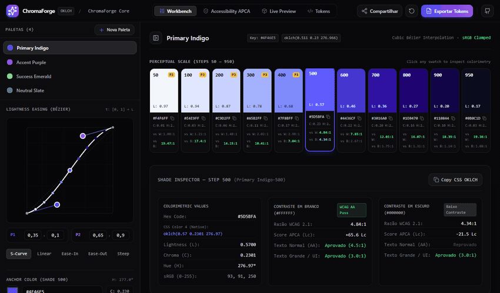

# ChromaForge

> **Estúdio de engenharia colorimétrica no espaço OKLCH e compilador universal de design tokens. Processamento 100% no cliente, sem backend, sem dependências de rede e com precisão numérica em ponto flutuante de 64 bits.**

<p align="center">
  <a href="https://pedrobosa.github.io/ChromaForge/"></a>
  <a href="LICENSE"></a>
  <a href="https://github.com/PedroBosa"></a>
</p>

<p align="center">
  
  
  
  
  
</p>

<p align="center">
  
</p>

---

## Visão geral

O **ChromaForge** é um estúdio de engenharia cromática projetado para construção, parametrização e auditoria de rampas de cores em sistemas de design modernos.

Seletores convencionais e geradores de tokens operam tradicionalmente sobre os espaços HSL ou HSV, cujas bases baseiam-se em modelos geométricos ingênuos do cubo sRGB. Nesses espaços, amostras com o mesmo valor nominal de luminosidade possuem brilho perceptivo divergente: o amarelo puro (`hsl(60, 100%, 50%)`) possui luminância relativa superior a **6 vezes** a do azul puro (`hsl(240, 100%, 50%)`), resultando em quebras de contraste imprevisíveis e falhas de acessibilidade estruturais ao alternar matrizes cromáticas.

O ChromaForge baseia seus cálculos nativamente no espaço perceptual **OKLCH** (*Oklab Cylindrical*), formulado por Björn Ottosson (2020), garantindo:
- **Uniformidade perceptual:** passos nominais idênticos (por exemplo, `500` em Índigo, Esmeralda ou Carmim) preservam luminosidade percebida ($L$) matematicamente uniforme.
- **Predição determinística de contraste:** avaliação óptica simultânea sob WCAG 2.1 e APCA 0.98G-4g (*Accessible Perceptual Contrast Algorithm*).
- **Mapeamento de gamut não-destrutivo:** algoritmo de busca binária no canal de croma para contenção de coordenadas fora dos limites físicos sRGB e Display P3 sem distorção angular de matiz (*hue shift*).

---

## Destaques de engenharia

### 1. Pipeline de transformações colorimétricas puras
Todas as conversões são implementadas em rotinas matemáticas desacopladas do DOM e do React (`src/core/color/conversions.ts`), utilizando precisão numérica IEEE 754 de 64 bits.

**Expansão gama sRGB $\leftrightarrow$ Linear sRGB (IEC 61966-2-1):**  
Para cada canal normalizado $C \in [0, 1]$:

$$C_{\text{linear}} = \begin{cases} \dfrac{C}{12.92}, & C \le 0.04045 \\[8pt] \left( \dfrac{C + 0.055}{1.055} \right)^{2.4}, & C > 0.04045 \end{cases}$$

**Espaço Linear sRGB $\rightarrow$ Oklab:**  
O sinal linear $(R_{\text{lin}}, G_{\text{lin}}, B_{\text{lin}})$ é projetado na matriz de resposta de cones oculares $M_1$ para derivar o espaço LMS:

$$\begin{bmatrix} l \\ m \\ s \end{bmatrix} = \begin{bmatrix} 0.4122214708 & 0.5363325363 & 0.0514459929 \\ 0.2119034982 & 0.6806995451 & 0.1073969566 \\ 0.0883024619 & 0.2817188376 & 0.6299787005 \end{bmatrix} \begin{bmatrix} R_{\text{lin}} \\ G_{\text{lin}} \\ B_{\text{lin}} \end{bmatrix}$$

Aplica-se a compressão não-linear por raiz cúbica:

$$l' = \sqrt[3]{l}, \quad m' = \sqrt[3]{m}, \quad s' = \sqrt[3]{s}$$

As coordenadas cartesianas Oklab $(L, a, b)$ são extraídas pela matriz $M_2$:

$$\begin{bmatrix} L \\ a \\ b \end{bmatrix} = \begin{bmatrix} 0.2104542553 & 0.7936177850 & -0.0040720468 \\ 1.9779984951 & -2.4285922050 & 0.4505937099 \\ 0.0259040371 & 0.7827717662 & -0.8086757660 \end{bmatrix} \begin{bmatrix} l' \\ m' \\ s' \end{bmatrix}$$

**Projeção cilíndrica OKLCH:**  
$$C = \sqrt{a^2 + b^2}, \qquad H = \left( \operatorname{atan2}(b, a) \cdot \frac{180}{\pi} \right) \pmod{360}$$

### 2. Algoritmo de contenção de gamut por busca binária
Quando uma coordenada OKLCH calculada extrapola os limites físicos do espaço de cor de destino (cubo unitário $[0, 1]^3$ em sRGB), o truncamento direto (*clamping*) dos canais individuais causaria distorções severas de matiz e perda de luminosidade.

O ChromaForge aplica o método de busca binária no canal de croma $C$, mantendo rigorosamente constantes a Luminosidade $L$ e o Ângulo de Matiz $H$:

$$C_{\text{mid}} = \frac{C_{\text{low}} + C_{\text{high}}}{2}$$

A cada iteração $i \in [1, 24]$, testa-se se a coordenada $(L, C_{\text{mid}}, H)$ reside no gamut sRGB ($\text{isInSrgbGamut}$). A convergência garante tolerância $\epsilon \le 10^{-4}$ ($0.0001$), localizando a fronteira exata de saturação física sem aberrações cromáticas.

### 3. Avaliação de acessibilidade: WCAG 2.1 vs. APCA 0.98G-4g
O motor implementa simultaneamente os dois modelos de contraste óptico:

- **WCAG 2.1 (Luminância relativa linear):**
  $$Y = 0.2126729 R_{\text{lin}} + 0.7151522 G_{\text{lin}} + 0.0721750 B_{\text{lin}}$$
  $$\text{Razão} = \frac{\max(Y_1, Y_2) + 0.05}{\min(Y_1, Y_2) + 0.05}$$

- **APCA 0.98G-4g (W3C Silver / WCAG 3.0 draft):**  
  Modela a resposta visual espacial humana, o espalhamento de luz em níveis escuros (*black-level stray light flare*) e a sensibilidade assimétrica à polaridade:
  - Compensação de *flare* para $Y \le 0.022$: $Y_{\text{comp}} = Y + (0.022 - Y)^{1.414}$.
  - Texto escuro em fundo claro (polaridade normal / BoW):
    $$S_{\text{apc}} = \left( Y_{\text{bg}}^{0.56} - Y_{\text{txt}}^{0.57} \right) \cdot 1.14$$
  - Texto claro em fundo escuro (polaridade reversa / WoB):
    $$S_{\text{apc}} = \left( Y_{\text{bg}}^{0.65} - Y_{\text{txt}}^{0.62} \right) \cdot 1.14$$
  - Pontuação final $L^c$: atenuação de baixo contraste ($|S_{\text{apc}}| \ge 0.1$) multiplicada por $100$, variando de $-108.0$ a $+106.0$.

### 4. Interpolação paramétrica por curvas de Bézier e envelopes de croma
A progressão de luminosidade dos 11 tons (passos nominais `50` a `950`) é determinada pela resolução numérica de curvas cúbicas de Bézier com pontos de ancoragem $P_0 = (0, 0)$ e $P_3 = (1, 1)$, e manipuladores $P_1 = (x_1, y_1)$ e $P_2 = (x_2, y_2)$:

$$B_x(t) = 3(1-t)^2 t x_1 + 3(1-t) t^2 x_2 + t^3$$

A equação $B_x(t) = x$ é resolvida para o parâmetro $t$ através do método iterativo de **Newton-Raphson** (com fallback garantido por bisseção em caso de derivada nula), avaliando subsequentemente $B_y(t)$ para extrair o valor exato de luminosidade $L$.

A distribuição de saturação ao longo da escala utiliza um envelope parabólico ponderado:

$$E(t) = 0.15 + 0.85 \cdot \big(4t(1 - t)\big)$$

O ápice de saturação concentra-se no passo médio $t = 0.5$ (tom `500`), decaindo suavemente em direção aos tons claros (`50`) e profundos (`950`), prevenindo supersaturação periférica.

---

## Recursos

- **Espaço colorimétrico estrito:** manipulação direta em OKLCH com transição suave entre matizes e sem artefatos de rotação.
- **Editor interativo de Bézier SVG:** interface de ajuste contínuo de curvatura com manipuladores tangenciais, pontos de controle interativos e predefinições (*S-Curve*, *Linear*, *Ease-In*, *Ease-Out*, *Steep*).
- **Matriz de contraste óptico $11 \times 11$:** inspeção cruzada bidirecional entre todas as combinações de superfície e primeiro plano, com alternância em tempo real entre métricas WCAG 2.1 e escores APCA $L^c$.
- **Diagrama de cromaticidade 2D em tempo real:** renderização acelerada em elemento `<canvas>` mapeando as fronteiras físicas de projeção dos espaços sRGB e Display P3 no plano Oklab $(a, b)$.
- **Exportação multiformato:**
  - Tailwind CSS v4 (`@theme { --color-*: oklch(...); }`) com anotação opcional de fallback hex.
  - Tailwind CSS v3 (`tailwind.config.js`).
  - Variáveis CSS nativas (`:root { --color-*: ... }`) encapsuladas em blocos `@supports (color: oklch(0 0 0))`.
  - Especificação padrão W3C Design Tokens Community Group (formato JSON estruturado).
  - Constantes tipadas em TypeScript (`export const colors = { ... } as const`).
- **Simulação de componentes SaaS:** painel de teste dinâmico com botões, cards, badges e alertas aplicando as cores geradas com estados derivados ($\Delta L$).

---

## Privacidade e segurança

- **Execução estritamente local:** todo o processamento colorimétrico e de exportação de tokens ocorre na memória do navegador.
- **Ausência de telemetria:** nenhuma requisição HTTP externa é disparada para serviços analíticos ou de rastreamento em tempo de execução.
- **Fontes locais:** declarações de estilo utilizam a pilha tipográfica nativa do sistema operacional (`Geist`, `JetBrains Mono`, `system-ui`).
- **Persistência desacoplada:** o armazenamento em `localStorage` destina-se unicamente ao cache de configurações de paleta do usuário no domínio local.

---

## Estrutura do projeto

```text
ChromaForge/
├── .github/
│   ├── ISSUE_TEMPLATE/
│   │   ├── bug_report.yml          # Formulário padronizado para relato de bugs
│   │   ├── config.yml              # Configuração de issues e canal de segurança
│   │   └── feature_request.yml     # Formulário padronizado para sugestões
│   ├── workflows/
│   │   ├── ci.yml                  # Validação estática de tipos e build em PRs
│   │   └── deploy.yml              # Build e publicação no GitHub Pages
│   ├── CODEOWNERS                  # Definição de propriedade de código (@PedroBosa)
│   ├── dependabot.yml              # Atualização semanal de dependências npm e actions
│   └── PULL_REQUEST_TEMPLATE.md    # Checklist de verificação para pull requests
├── src/
│   ├── core/                       # Núcleo de computação matemática pura (Zero-DOM, Zero-React)
│   │   ├── color/
│   │   │   ├── bezier.ts           # Resolvedor de curvas cúbicas de Bézier (Newton-Raphson)
│   │   │   ├── contrast.ts         # Cálculo de contraste óptico WCAG 2.1 e APCA 0.98G-4g
│   │   │   ├── conversions.ts      # Conversões sRGB, Linear, CIE XYZ D65, Oklab, OKLCH e gamut
│   │   │   ├── index.ts            # Ponto de exportação do módulo de cores
│   │   │   └── scale-generator.ts  # Gerador de escala em 11 passos com envelope parabólico
│   │   └── tokens/
│   │       ├── formatters.ts       # Compiladores para Tailwind v4, Tailwind v3, CSS, W3C e TS
│   │       └── index.ts            # Ponto de exportação do módulo de tokens
│   ├── modules/                    # Componentes modulares da interface
│   │   ├── accessibility/          # Matriz de contraste 11x11 e inspetor tipográfico
│   │   ├── exporter/               # Modal de visualização e exportação de tokens
│   │   ├── gamut-map/              # Diagrama de cromaticidade 2D em canvas Oklab (a, b)
│   │   ├── preview/                # Visualizador de componentes UI com estados derivados
│   │   ├── scale-editor/           # Editor interativo de curvas SVG e controles OKLCH
│   │   └── workbench/              # Barra superior, seletor de rampa e faixa de 11 tons
│   ├── store/
│   │   └── useChromaStore.ts       # Gerenciamento de estado global com persistência Zustand
│   ├── styles/
│   │   └── index.css               # Estilos base, resets e tokens globais
│   ├── types/                      # Definições estritas de interfaces e tipos de domínio
│   ├── App.tsx                     # Ponto de montagem da interface do estúdio
│   └── main.tsx                    # Inicialização do React 18 no nó raiz
├── .editorconfig                   # Padronização de indentação e formatação
├── .gitattributes                  # Normalização de finais de linha (LF)
├── .gitignore                      # Exclusão de artefatos de compilação e dependências
├── .nvmrc                          # Versão recomendada do Node.js (22)
├── CHANGELOG.md                    # Histórico de alterações estruturado
├── CODE_OF_CONDUCT.md              # Código de conduta Contributor Covenant 2.1
├── CONTRIBUTING.md                 # Guia para desenvolvimento e envio de contribuições
├── index.html                      # Ponto de entrada HTML com metadados estruturados
├── LICENSE                         # Licença permissiva MIT
├── package.json                    # Metadados e scripts de compilação
├── postcss.config.js               # Configuração do PostCSS
├── README.md                       # Documentação técnica central
├── SECURITY.md                     # Política de reporte de vulnerabilidades
├── tailwind.config.js              # Configuração de tokens utilitários Tailwind CSS
├── tsconfig.json                   # Configuração estrita do compilador TypeScript
└── vite.config.ts                  # Configuração do empacotador Vite e base path
```

---

## Primeiros passos

### Pré-requisitos
- Node.js versão 20 LTS ou 22 LTS (verifique com `node --version`).
- npm versão 10 ou superior.

### Instalação e execução
```bash
git clone https://github.com/PedroBosa/ChromaForge.git
cd ChromaForge
npm ci
npm run dev
```

### Build e verificação
```bash
npm run typecheck
npm run build
npm run preview
```

---

## Compatibilidade

| Navegador / Plataforma | Suporte | Observações |
|---|---|---|
| Google Chrome / Chromium $\ge 111$ | Integral | Suporte nativo à notação CSS Color 4 `oklch()` e aceleração de canvas 2D. |
| Microsoft Edge $\ge 111$ | Integral | Comportamento equivalente à plataforma Chromium. |
| Apple Safari $\ge 15.4$ | Integral | Suporte pleno ao espaço Oklab e renderização com ampla gama Display P3. |
| Mozilla Firefox $\ge 113$ | Integral | Suporte nativo a `oklch()` e renderização precisa de matrizes APCA. |
| Dispositivos Móveis | Suporte de consulta | Interface técnica de alta densidade otimizada preferencialmente para desktops. |

---

## Stack e tecnologias

| Tecnologia | Versão | Função na arquitetura |
|---|---|---|
| React | 18.3.1 | Renderização declarativa dos painéis de visualização |
| TypeScript | 5.6.3 | Tipagem estática estrita em todas as matrizes e algoritmos |
| Vite | 5.4.11 | Servidor de desenvolvimento rápido e empacotamento de produção |
| Zustand | 4.5.5 | Gerenciamento centralizado de estado com middleware de persistência |
| Tailwind CSS | 3.4.15 | Estilização utilitária de componentes e tokens de interface |
| Lucide React | 1.16.0 | Biblioteca de ícones técnicos consistentes |

---

## Limitações conhecidas

- **Mapeamento de gamut em monitores sRGB:** a renderização visual de cores Display P3 em telas restritas ao gamut sRGB convencional depende da aproximação de hardware do sistema operacional, exibindo tons fisicamente limitados ao espaço nativo do monitor.
- **Suporte de navegadores legados à sintaxe `oklch()`:** versões do Chromium anteriores a 111 ou Safari anteriores a 15.4 não interpretam funções CSS Color Module 4 nativamente; recomenda-se utilizar o compilador com opção de fallback hex ativada.
- **Precisão analítica em limites de saturação:** para valores de Luminosidade extremos ($L \le 0.001$ ou $L \ge 0.999$), a croma limite física converge para zero, neutralizando a diferenciação de matiz ($H$) independentemente do ângulo configurado.
- **Aceleração 2D de canvas em monitores de alta escala:** em resoluções com fator de escala de DPI elevado ($>2.0$), a renderização pontual contínua de todo o plano $(a, b)$ do diagrama de cromaticidade consome ciclos adicionais de GPU integrada durante redimensionamentos bruscos da janela.

---

## Contribuindo

Contribuições que ampliem a precisão matemática ou a eficiência dos compiladores de tokens são bem-vindas. Consulte o guia detalhado em [`CONTRIBUTING.md`](CONTRIBUTING.md) antes de enviar alterações. Relatos de vulnerabilidades de segurança devem seguir as instruções em [`SECURITY.md`](SECURITY.md).

---

## Licença

Distribuído sob a licença MIT. Consulte [`LICENSE`](LICENSE) para mais informações.

Desenvolvido por [Pedro Bosa](https://github.com/PedroBosa).
